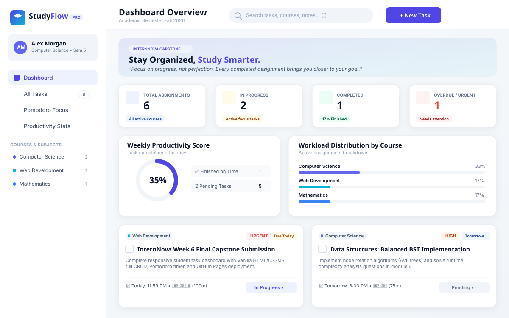

# 🎓 StudyFlow — Student Task & Productivity OS

> **InternNova Week 6 Final Web Development Project**  
> A complete, professional, modern, responsive, and interactive Student Task & Productivity Management platform built exclusively using **Semantic HTML5, CSS3, and Vanilla JavaScript (ES6+)**. Zero external frameworks or heavy libraries.

[](https://developer.mozilla.org/en-US/docs/Web/HTML)
[](https://developer.mozilla.org/en-US/docs/Web/CSS)
[](https://developer.mozilla.org/en-US/docs/Web/JavaScript)
[](LICENSE)
[](https://aravindkumargs.github.io/STUDENT-TASK-MANAGER/)

---

<p align="center">
  
</p>

---

## 🚀 Live Demo & Repository
- **Live Website**: [https://aravindkumargs.github.io/STUDENT-TASK-MANAGER/](https://aravindkumargs.github.io/STUDENT-TASK-MANAGER/)
- **GitHub Repository**: [https://github.com/ARAVINDKUMARGS/STUDENT-TASK-MANAGER](https://github.com/ARAVINDKUMARGS/STUDENT-TASK-MANAGER)
- **Application Path**: [`student-task-manager/index.html`](./student-task-manager/index.html)
- **Formal Project Report**: [`student-task-manager/PROJECT_REPORT.md`](./student-task-manager/PROJECT_REPORT.md)
- **Full Project Documentation**: [Complete Guide & README](./student-task-manager/README.md)

---

## 📖 Quick Start

1. Open [`student-task-manager/index.html`](./student-task-manager/index.html) in any web browser.
2. Alternatively, run a local web server:
   ```bash
   python -m http.server 8000
   ```
   and visit `http://localhost:8000/student-task-manager/index.html`.

For complete feature documentation, git instructions, and the official 400-500 word capstone report, see [`student-task-manager/README.md`](./student-task-manager/README.md).
